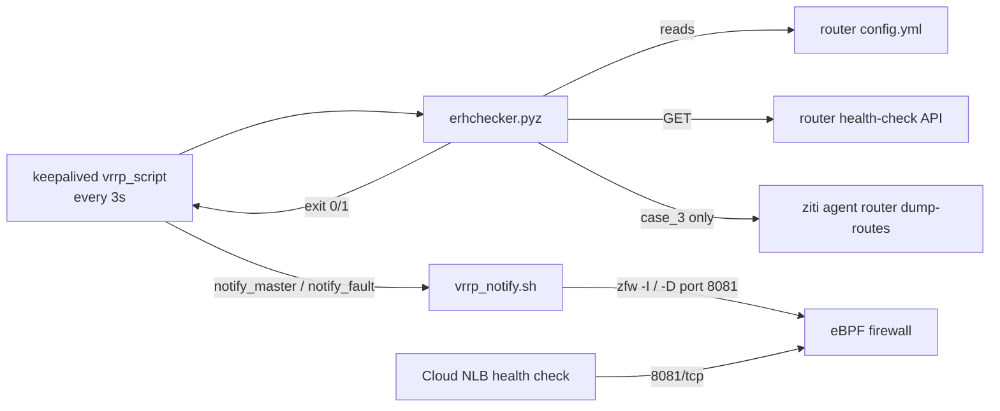

# CLAUDE.md

This file provides guidance to Claude Code (claude.ai/code) when working with code in this repository.

## What this is

`erhchecker.pyz` — a single-file Python zipapp that keepalived runs as a `vrrp_script` to decide whether an OpenZiti/CloudZiti edge router is healthy. It exits `0` (healthy/stay master) or `1` (fail over). All logic is in `src/hcapp.py`; `src/__main__.py` only calls `sys.exit(hcapp.main())`. Imports are flat (`import hcapp`), so modules must stay side-by-side in one directory.

## Commands

Lint (the only CI gate). Locally use the project venv (`.venv/`, gitignored; contains pylint plus the runtime deps pyyaml, requests, jsonschema, colorama):
```bash
python3 -m venv .venv && .venv/bin/pip install pylint pyyaml requests jsonschema colorama   # first time only
.venv/bin/pylint --rcfile .pylintrc src/*
```
`main` already exceeds `max-complexity=10`; that warning predates the 1.2.0 changes and does not fail CI (`fail-under=9.5`).

Build the zipapp (mirrors `.github/workflows/ci.yml`):
```bash
mkdir erhchecker && cp src/* erhchecker/
python3 -m pip install -r files/requirements.txt --target erhchecker --upgrade
python3 -m zipapp -p "/usr/bin/python3" --compress --output erhchecker.pyz erhchecker
```

Run locally without building: `python3 src -c <router config.yml> -l DEBUG`

There is no test suite.

## Configuration

Each setting is a CLI flag, or an environment variable when the flag is absent (`parse_variables`):

| Flag | Env var | Default |
|---|---|---|
| `-c/--routerConfigFilePath` | `ROUTER_CONFIG_FILE_PATH` | `/opt/netfoundry/ziti/ziti-router/config.yml` |
| `-z/--zitiBinaryFilePath` | `ZITI_BINARY_FILE_PATH` | `/opt/netfoundry/ziti/ziti` |
| `-t/--switchTimeout` | `SWITCH_TIMEOUT` | `600` (seconds) |
| `-r/--noTFlagRoutersFilePath` | `NO_T_FLAG_ROUTERS_FILE_PATH` | `""` (YAML `routerIds:` list, validated against `SCHEMA_ROUTERIDS`) |
| `-l/--logLevel` | `LOG_LEVEL` | `INFO` |
| `-f/--logFile` | `LOG_FILE` | `""` (console only) |

## Decision logic (`hcapp.main`)

1. Parse the router config YAML → find the `web` entry named `health-check` → build `https://127.0.0.1:<port>/<binding>` (`get_hc_url`).
2. Collect controller addresses (`get_ctrl_endpoints`): `ctrl.endpoint` or the `ctrl.endpoints` list, plus the `endpoints:` list from the router's controller endpoints file (`ctrl.endpointsFile`, default `<config dir>/endpoints.yml`, written by the router at runtime for HA controllers). The router writes that file as root with mode 0600, so `read_endpoints_file` falls back to `sudo -n cat`. Resolve all of them to IPs (`resolve_ctrl_ips`).
3. GET the health endpoint (TLS verification disabled) → pull the `controllerPing` and `link.health` checks (`evaluate_health`).
4. Filter `link.health` details (`filter_links`): drop links to routers listed in the no-traversal file, and drop links whose remote IP is any controller IP (the fabric-only routers co-located on controller hosts). Link `addresses` keys vary by openziti version and link type (`ack`/`payload` before v1.6.6; `link.ack`/`link.default`/`single` after; see ziti `router/router.go` `linkHealthCheck`), so `link_remote_ips` reads every entry and never relies on a specific key.
5. Dispatch on `(controllerPing.healthy, any remaining links)`:
   - `(T,T)` → `case_0` → 0
   - `(F,F)` → `case_1` → 1
   - `(T,F)` → `case_2` → 1
   - `(F,T)` → `case_3` → 1 if there are ≤2 circuits (via `sudo <ziti> agent router dump-routes --app-type router`; 2 circuits belong to the management plane) or `failingSince` is older than `switchTimeout`, else 0 (lets circuits drain).

Return codes when something goes wrong (preserve these deliberately):
- **0** (don't fail over): router config is empty or unparsable, has no `health-check` web entry, or no controller address can be found or resolved.
- **1** (fail over): the health endpoint can't be reached or its body isn't JSON with `data`, or the health data has an unexpected shape (logged as ERROR in `main`; can't verify local health, so hand over to the peer).
- A router config path that doesn't exist currently raises out of `parse_yaml_file` (`os.path.getsize`), which crashes and exits 1.

## Deployment context (`files/`)

`files/` is not packaged. It holds reference artifacts for the HA / cloud load-balancer setup described in README.md: keepalived master/backup configs, `vrrp_notify.sh` (opens or closes 8081/tcp via `zfw`), and `cloud-init.cfg` plus helper scripts (`diverter.sh` installs zfw and downloads the latest `erhchecker` release asset into `/opt/netfoundry`).



## Dependencies gotcha

`files/requirements.txt` bundles only `colorama` into the zipapp. `yaml`, `requests`, `urllib3` and `jsonschema` are imported but not bundled, so they must already be installed in the target host's `/usr/bin/python3` (inferred from the build; not verified on a router image). If you add an import, either add it to `requirements.txt` or confirm it is present on the host.

## Release process

- The version is hard-coded as `__version__` in `get_arguments()` in `src/hcapp.py`. `release.yml` reads it via `./erhchecker.pyz -v` and creates the tag `v<version>`, so **bump `__version__` and `CHANGELOG.md` (Keep a Changelog format) in every PR**. Otherwise the release step collides with an existing tag.
- `release.yml` runs on `pull_request: closed` and does not check whether the PR was merged. Closing a PR without merging still attempts a release. It also skips pylint.
- The release asset is `erhchecker_linux_amd64.tar.gz`, which contains `erhchecker.pyz`.
